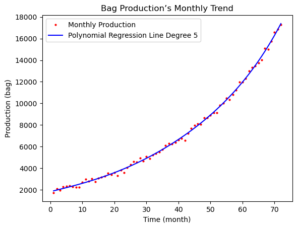
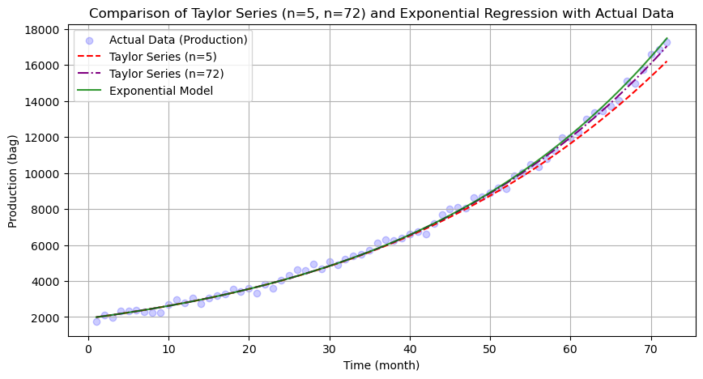
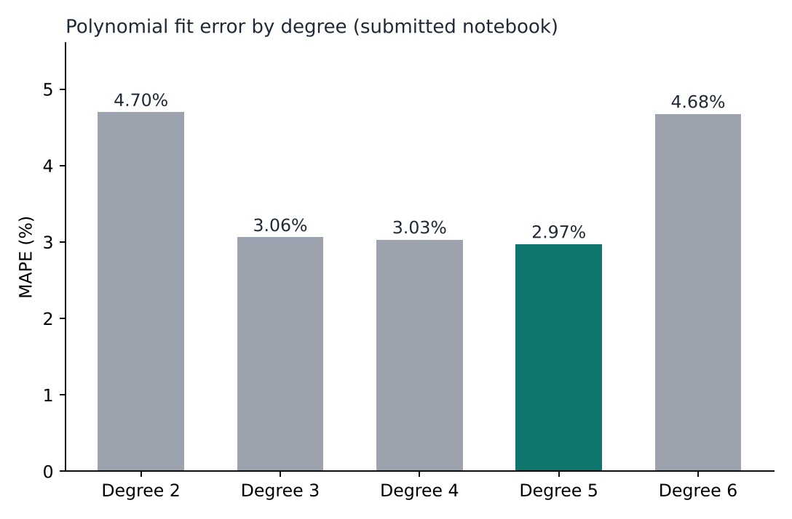
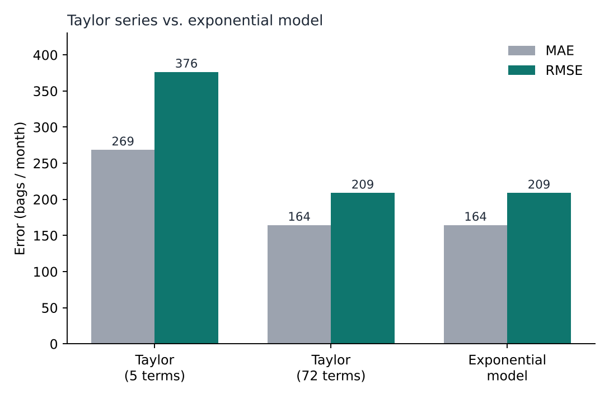

# Production Capacity Forecasting

> Polynomial and exponential trend models for a fictional bag manufacturer, with root-finding (Newton-Raphson, bisection) to predict when a 25,000-bag warehouse is outgrown.

## Overview

Scientific Computing (MATH6183001) assignment of learning (AOL). As a data analyst for the fictional bag maker EGIER, the task was to (1) find a non-linear trend in 6 years of production data, (2) convert the model into a numerical approximation and explain its accuracy, and (3) predict when the 25,000-bag warehouse capacity is exceeded, given that a new warehouse needs at least 13 months to build.

## Data / Scope

- 144 raw observations for January 2018 - December 2023. Two observations belong to one month, so they were averaged into 72 monthly values (`data/monthly_production_aggregated.csv`, copied from the notebook output).
- The raw course file `aol_data.csv` is not included; the notebook expects it in the working directory.
- A linear model was explicitly ruled out by the assignment.

## Workflow

1. **Trend model:** least-squares polynomial regression of degree 2-6 using the normal equations (NumPy), compared with MAE, MSE, RMSE and MAPE.
2. **Numerical form:** Taylor series of an exponential model fitted by log-linear regression (`scipy.stats.linregress`), with 5 and 72 terms.
3. **Warehouse deadline:** root of `f(x) - 25,000 = 0` with Newton-Raphson and bisection implemented from scratch.

## Results

| Degree | MAE | RMSE | MAPE |
|---|---|---|---|
| 2 | 239.0 | 294.4 | 4.70% |
| 3 | 156.6 | 196.8 | 3.06% |
| 4 | 150.4 | 188.4 | 3.03% |
| **5** | **148.4** | **187.3** | **2.97%** |
| 6 (notebook) | 388.3 | 628.2 | 4.68% |

Exponential model: MAE 164.5, RMSE 209.0. Taylor series with 5 terms is clearly worse (MAE 268.7, RMSE 376.5) while 72 terms matches the exponential model (MAE 164.5, RMSE 209.0), which is the accuracy argument for the numerical conversion.






**Conclusion in the submitted notebook:** the capacity is exceeded around month 87 (early 2025), so construction should start in January 2024.

### Re-check (read this before reusing the numbers)

While preparing this repository I re-ran the analysis with a numerically stable solver (`scripts/recheck_with_polyfit.py`). The model choice (degree 4-5 polynomial, exponential trend) holds, but several details of the notebook do not:

- The degree-6 error jump in the notebook comes from solving the ill-conditioned normal equations with `inv(A.T @ A)`; with `np.polyfit` degree 6 is on par with degree 5 (MAPE 2.97%), so it is not evidence of overfitting.
- The root-finding cells use polynomial coefficients rounded to 4 decimals (the degree-5 `x^5` term becomes `0.0000`), and the degree-4 `f(x)` has a line break after `x` that drops the constant `1915.7393 - 25000` from the `return`. Because of this, Newton-Raphson reports "Not converged", bisection reports "Invalid points", and the stated root of 86.9 is not reproduced.
- With full-precision coefficients the 25,000-bag capacity is reached at month 82.7 (degree 5), 83.7 (degree 4 and exponential) and 85.4 (degree 3), i.e. around **November 2024 - January 2025**. With a 13-month build time, construction would need to start around **October 2023 - December 2023**, a few months earlier than the notebook's January 2024.

The notebook is kept unchanged (apart from removing the student ID) so it matches the submission.

## Tech Stack

Python, NumPy, pandas, SciPy, Matplotlib, Jupyter.

## Repository Structure

```
notebooks/   Production_Capacity_Forecasting.ipynb (original submission)
data/        monthly_production_aggregated.csv (72 monthly values from the notebook output)
figures/     fit, Taylor comparison, MAPE by degree, model error charts
scripts/     recheck_with_polyfit.py (stable re-fit and root check)
```

## How to Run

```bash
pip install -r requirements.txt
python scripts/recheck_with_polyfit.py
jupyter notebook notebooks/Production_Capacity_Forecasting.ipynb   # needs aol_data.csv next to the notebook
```

## Notes

- Individual assignment for Scientific Computing, BINUS University.
- `figures/pcf-fit.png` and `figures/pcf-taylor.png` are exported from the notebook; the other two charts are drawn from its reported numbers (MAE/RMSE for Taylor 72 terms re-computed: 164.5 / 209.0 vs. 162.1 / 206.7 quoted in the notebook text).

## Author

Nadya Angelie Lislie - [LinkedIn](https://www.linkedin.com/in/nadya-angelie-lislie/)

## Continuous Integration

GitHub Actions (`.github/workflows/ci.yml`) runs `ruff` and `pytest` repository-health checks on every push; run them locally with `make lint test`.
